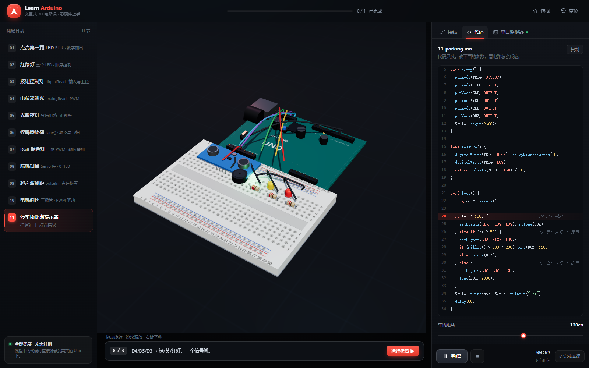
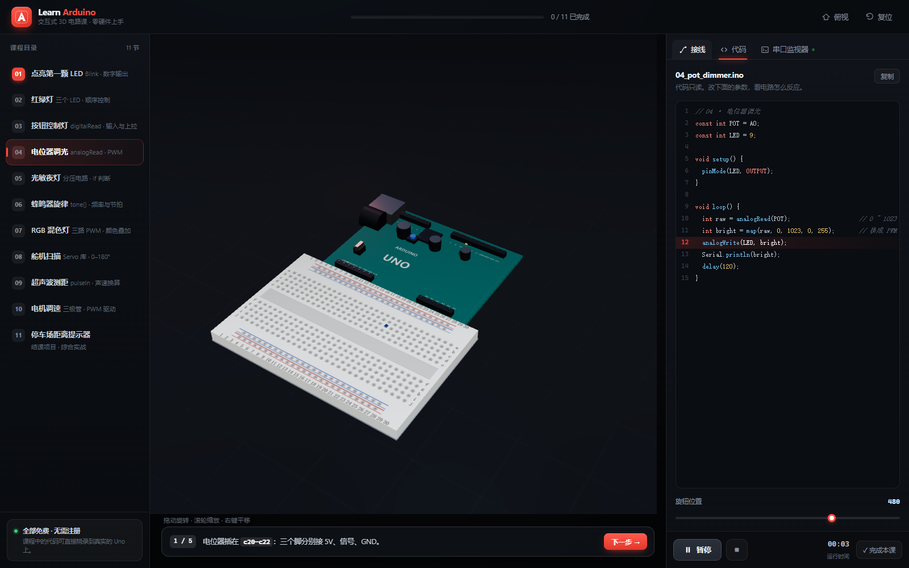
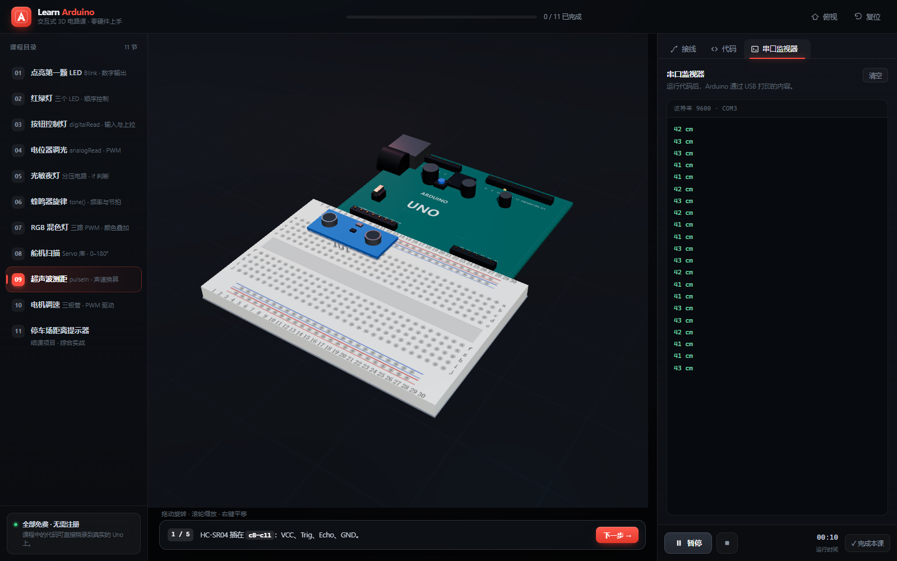
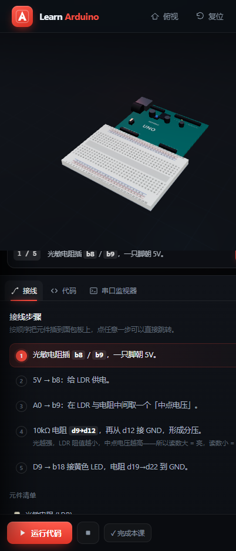

# Learn Arduino · 交互式 3D 电路课

一块 3D 的 Arduino Uno 和面包板摆在屏幕中间，跟着分步提示把元件插上去、把线接好，点「运行代码」，灯就真的亮起来、舵机就真的转起来、串口就真的往外吐数据。

纯前端静态站点，**零依赖、零构建**：一个 `index.html` 加几个原生 ES Module，three.js 已本地化，断网也能跑。

> 本项目是对 [learn-arduino-red.vercel.app](https://learn-arduino-red.vercel.app) 的复刻实现，详见文末「与原站的关系」。

---

## 效果预览

以下都是站点实际运行时的整页截图（含 WebGL 3D 画面），不是示意图。

**第 11 课「停车场距离提示器」**——8 个元件、12 根导线全部接好，右侧是只读代码与随运行实时高亮的当前行。



**第 4 课「电位器调光」**——代码页和可调参数。改滑条等于改代码里的常量，3D 里的 LED 亮度会跟着变。



**第 9 课「超声波测距」**——串口监视器正在打印距离读数，模拟 `Serial.print(cm)` 的输出。



**窄屏布局**（402×939）——三栏自动切换为上下堆叠，课程目录收进抽屉。



---

## 快速开始

因为用了 ES Module 和 `importmap`，**必须通过 http 协议访问**。直接双击 `index.html` 会因 `file://` 下的 CORS 限制白屏。

任选一种：

```bash
# Python（大多数机器自带）
cd learn-arduino
python -m http.server 8823
# 打开 http://localhost:8823/
```

```bash
# Node
npx serve .
```

```bash
# 已经装了 PHP
php -S localhost:8823
```

浏览器打开 `http://localhost:8823/` 即可，无需登录、无需联网。

**环境要求**：支持 WebGL2 的现代浏览器（Chrome / Edge / Firefox / Safari 16+）。移动端可用，布局会切成上下堆叠。

---

## 界面

三栏布局：

| 区域 | 内容 |
| --- | --- |
| 左栏 | 11 节课的目录，带完成状态勾选 |
| 中栏 | 3D 舞台：Arduino Uno + 面包板 + 元件 + 导线；左上角课程标题，左下一句话提示当前该做什么 |
| 右栏 | 三个标签页：**接线**（分步说明 + 元件清单）、**代码**（只读代码 + 参数滑条）、**串口监视器** |

顶栏有一条全局进度条，右侧是「俯视 / 复位」和窄屏下的目录抽屉开关。右栏底部是「运行代码 / 停止 / 计时 / 完成本课」。

---

## 课程

11 节课，从点灯一路做到一个能用的结课项目：

| # | 课程 | 技术点 | 文件 |
| --- | --- | --- | --- |
| 1 | 点亮第一颗 LED | `pinMode` / `digitalWrite` / `delay` | `01_blink.ino` |
| 2 | 红绿灯 | 三路数字输出、顺序控制 | `02_traffic.ino` |
| 3 | 按钮控制灯 | `digitalRead`、输入上拉 | `03_button.ino` |
| 4 | 电位器调光 | `analogRead` / `analogWrite` / PWM | `04_pot_dimmer.ino` |
| 5 | 光敏夜灯 | 分压电路、`if` 判断 | `05_nightlight.ino` |
| 6 | 蜂鸣器旋律 | `tone()`、频率与节拍 | `06_melody.ino` |
| 7 | RGB 混色灯 | 三路 PWM 叠加混色 | `07_rgb.ino` |
| 8 | 舵机扫描 | `Servo` 库、0–180° | `08_sweep.ino` |
| 9 | 超声波测距 | `pulseIn`、声速换算 | `09_sonar.ino` |
| 10 | 电机调速 | 三极管驱动、PWM 调速 | `10_motor.ino` |
| 11 | 停车场距离提示器 | 结课项目，综合前面所有内容 | `11_parking.ino` |

每节课包含：分步接线指引、元件清单、完整可烧录的 `.ino` 代码、可调参数、以及一个把「时间 + 参数」映射成电路状态的仿真函数。第 6 课蜂鸣器**会真的出声**（WebAudio 合成方波，不是音频文件）。

---

## 交互

**鼠标 / 触摸**

| 操作 | 效果 |
| --- | --- |
| 左键拖动 | 绕场景旋转（水平方向可 360° 连续转） |
| 滚轮 / 双指捏合 | 缩放 |
| 右键拖动 | 平移 |
| 上下拖动 | 限制在接近俯视到接近平视之间，不会钻到地板底下 |

相机采用「目标值 + 阻尼跟随」：拖动改的是目标球坐标，实际机位每帧向目标插值，所以松手后是顺滑减速停下，而不是硬停。

**键盘与按钮**

| 快捷键 / 按钮 | 效果 |
| --- | --- |
| `空格` | 运行 / 暂停 |
| `R` | 复位到斜视角 |
| `T` | 切俯视角 |
| `←` `→` | 上一步 / 下一步 |
| 舞台左上「斜视 / 俯视 / 特写」 | 三档预设机位 |
| 舞台左上「一键接线」 | 把本课所有导线一次接满 |
| 右栏任意一步 | 直接跳到那一步（导线和元件同步回退） |
| 点 3D 里的按键 | 第 3 课可以手动按下，看灯反应 |

各课的「完成」状态存在 `localStorage`（键名 `la-done`），关掉浏览器再回来勾选还在。当前看到第几课不持久化，每次打开都从第 1 课开始。

---

## 项目结构

```
learn-arduino/
├── index.html            185 行   页面骨架 + importmap
├── README.md                      本文档
├── css/style.css         517 行   深色主题、三栏栅格、响应式断点
├── docs/                          4 张运行截图（见「效果预览」）
├── js/
│   ├── geo.js             94 行   统一坐标系与引脚/孔位解析
│   ├── boards.js         405 行   桌面、面包板、Arduino Uno 建模
│   ├── parts.js          347 行   11 类电子元件建模
│   ├── lab.js            466 行   相机、取景、导线、播放渲染循环
│   ├── lessons.js        793 行   11 课数据 + 仿真函数 + 行号推导
│   └── app.js            479 行   状态机、UI 渲染、高亮、串口、音频
└── vendor/
    └── three.module.js              three.js r160（唯一第三方依赖）
```

**加载顺序**：`index.html` → `importmap` 把裸模块名 `three` 映射到 `./vendor/three.module.js` → `js/app.js` 作为入口，依次拉起 `geo` → `boards` / `parts` → `lab` → `lessons`。

---

## 技术实现

### 一套坐标系打通所有东西

全场景 **1 个世界单位 = 1 厘米**，面包板孔距 2.54mm 即 `0.254` 单位。所有孔位、引脚、元件尺寸都从这一个常数推导，所以「把 LED 插到 b8」这种人类语言能被精确换算成三维坐标。

`geo.js` 里的 `resolve(ref)` 负责解析三种引用写法：

| 写法 | 含义 |
| --- | --- |
| `'D13'` | Arduino 板上的数字引脚 13 |
| `'b8'` | 面包板第 b 行第 8 列 |
| `'rail:top:-:12'` | 顶部电源轨负极第 12 个孔 |

课程数据里写 `{ from: 'D13', to: 'b8' }`，渲染时自动查表得到两端坐标。

### 全部程序化建模，没有一个外部模型

没有 `.glb`、没有贴图文件。PCB 上的丝印（`ARDUINO` / `UNO` / `Made in Italy` / `www.arduino.cc`）、面包板上的孔圈与行列编号，都是用 `<canvas>` 现画再用 `CanvasTexture` 贴上去的。面包板那 33×10 + 4×25 个孔洞是真实几何体，用 `InstancedMesh` 一次画完，保证拖到侧面也看得见孔。

### 导线是长出来的，不是瞬间出现的

每根线用 `THREE.CatmullRomCurve3` 取 5 个控制点（起点、抬高 0.26、中点再抬高、抬高 0.26、终点）画成 `TubeGeometry`，再用 `setDrawRange()` 逐帧推进绘制范围。所以接线时看到的是线从引脚「爬」到孔里的过程。

### 机位是算出来的，不是写死的

`lab.js` 的 `_fit(name)` 会量出硬件加当前课程元件的包围盒，把 8 个角点投影到屏幕，迭代 3 次反推相机距离与注视点，直到内容落在画面 84% / 80% 的留白框内。所以第 1 课（两个元件）和第 11 课（八个元件加十二根线）都不会糊成一片，也不会小得像蚂蚁。

相机控制也没有用 three.js 自带的 `OrbitControls`——球坐标加阻尼插值不到一百行，自己写反而更容易控制夹取范围（俯仰限制在 0.10–1.50 弧度）和每帧的跟随节奏。

### 仿真和代码是联动的

每节课有一个纯函数：

```js
sim(t, p) {                    // t = 运行秒数，p = 参数对象
  const per = p.interval / 1000;
  const on = Math.floor(t / per) % 2 === 0;
  return {
    leds: { led1: on ? 1 : 0 },   // 元件亮度
    pin13: on ? 1 : 0,            // 板上 13 号脚指示灯
    codeLine: on ? this.lines.on : this.lines.off,  // 当前执行到哪一行
  };
}
```

返回的 `codeLine` 驱动代码区高亮，`leds` 驱动 3D 元件的颜色与自发光，`serial` 驱动串口输出，`buzz` 驱动发声，`servo` / `motor` / `pot` 驱动角度与转速。**没有预录动画**，一切由这个函数实时算。

高亮行号不用手写，`lineNo(code, needle)` 会在源码里搜特征串自动算出第几行，改代码不用同步改数字。

### 参数滑条

代码里写 `delay(⟦interval⟧)`，`⟦…⟧` 是占位符，渲染时替换成滑条的当前值。所以调滑条 = 改代码里的常量，语义是一致的。

### 其他

- 代码高亮用正则 tokenizer（注释 / 预处理指令 / 字符串 / 数字 / 关键字 / 函数名），不引入 Prism 之类的库。
- 蜂鸣器：`OscillatorNode` 方波 + `setTargetAtTime` 平滑换频，跟随 `tone()` 的频率。
- 暗色主题，主色 `#ff4b3e`（Arduino 红），辅助青绿 `#2fd4c6`。
- 响应式断点：`1360px` 收窄面板、`1180px` 侧栏转抽屉（带遮罩）、`880px` 改为上下堆叠。
- `window.__app` / `window.__lab` 暴露了 `load` / `setStep` / `run` / `switchTab` / `renderSerial` / `setActiveLine` 等调试接口，可直接驱动界面，便于自动化验证和批量截图。

---

## 新增一节课

在 `js/lessons.js` 的 `LESSONS` 数组里追加一个对象即可，UI 会自动出现。必填字段：

```js
{
  id: 'myLesson',              // 唯一标识
  no: 12,                      // 显示序号
  title: '我的新课',
  sub: '副标题 · 技术点',
  file: '12_mine.ino',
  brief: '一句话简介，显示在目录里。',
  params: [{ id: 'speed', label: '速度', min: 0.5, max: 3, step: 0.1, value: 1, unit: '×' }],

  parts: [                     // step = 第几步才出现，用于分步登场
    { id: 'led1', kind: 'led', color: 'red', hole: 'b8', step: 0 },
    { id: 'r1', kind: 'resistor', hole: 'd9', bands: [1, 1, 0], step: 1 },
  ],
  partList: [{ name: '红色 LED', qty: 1, color: '#ff3b30' }],

  wires: [{ from: 'D13', to: 'b8', color: C.teal }],

  steps: [                     // upTo = 走到这步时应该有几根线
    { upTo: 0, text: '把 LED 插到 <b>b8</b>。', note: '长脚正极。' },
    { upTo: 1, text: '接线。' },
  ],

  code: `void setup() { }\nvoid loop() { delay(⟦speed⟧); }`,
  markers: { on: ['digitalWrite(LED, HIGH)'] },   // 特征串 → 高亮行
  sim(t, p) {
    return { leds: { led1: t % 1 < 0.5 ? 1 : 0 }, codeLine: this.lines.on };
  },
}
```

要点：

- `parts` 里的 `hole` 是**元件 0 号引脚**的孔位，其余引脚沿 +X 方向自动排布，间距一个孔距。
- `sim` 用 `l.sim.call(l, t, params)` 调用，所以函数里 `this` 就是这节课，能拿到 `this.lines`。
- 需要新的元件类型，在 `js/parts.js` 写个构建函数并加进 `PARTS` 映射即可，局部原点放在 0 号引脚处。

---

## 已知限制

- **元件是极简几何体**，不是精细模型。LED 是圆柱加半球，HCSR04 是两个圆筒加一块板，风格偏示意而非拟真。
- **没有真正的物理/电气仿真**。短路、漏电、供电不足这些都不会出问题——`sim()` 只负责让画面正确响应，不负责让电路正确工作。
- **代码不能编辑、不能上传**，只能调参数。这是刻意和原站保持一致的设计。
- 串口输出是仿真生成的文本，不是真的串口通信。
- 未做无障碍适配（拖拽式 3D 交互本身对键盘用户不友好）。

---

## 与原站的关系

原站 `learn-arduino-red.vercel.app` 在开发环境中无法直连（直连超时、走代理 502、第三方镜像同样超时），因此本项目是**按公开报道中描述的形态与课程结构重做**的：3D Arduino + 面包板居中，右侧只读代码区与串口监视器，11 节免费课，参数滑条可调，蜂鸣器那节有声音。

也就是说，**定位、布局思路和课程脉络对齐，但不是逐像素扒站**，配色、措辞、元件造型、提示文案都是重新写的。原作者是 Dilum Sanjaya。

---

## 许可

课程代码片段（`.ino` 内容）是公开的 Arduino 入门教学代码，可自由使用。场景建模与前端代码为本项目原创。
